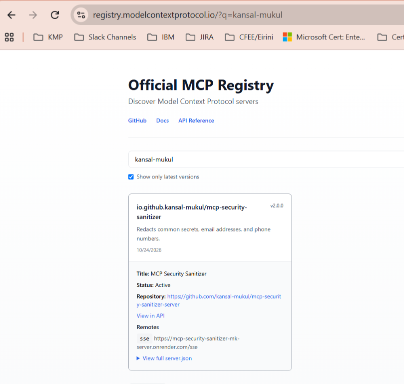

# MCP Security Sanitizer

A small MCP server that provides local, regex-based tools for redacting common
secrets and personally identifiable information (PII).

## Use the published server

This project is configured for publication in the
[official MCP Registry](https://registry.modelcontextprotocol.io/?q=kansal-mukul)
under the server name `io.github.kansal-mukul/mcp-security-sanitizer`.
After publishing, search for that name and add the server to an MCP client
that supports remote servers over SSE.



You can also add the endpoint directly in a client that supports SSE:

```text
https://mcp-security-sanitizer-mk-server.onrender.com/sse
```

For example, in VS Code, add this to `.vscode/mcp.json` in your workspace:

```json
{
  "servers": {
    "mcp-security-sanitizer": {
      "type": "sse",
      "url": "https://mcp-security-sanitizer-mk-server.onrender.com/sse"
    }
  }
}
```

After connecting, select one of the tools below and provide its `text`
argument. The Render free service may take about a minute to respond when it
has been idle and needs to wake up.

> Regex matching only recognizes the patterns implemented here. It cannot
> guarantee detection of every secret or PII value. Validate the patterns
> against your requirements before relying on this service.

## Tools

| Tool | Behavior |
| --- | --- |
| `mask_api_keys_and_secrets(text)` | Redacts OpenAI-style `sk-...` keys, bearer tokens, and common named key/secret/password/token assignments. |
| `mask_pii_data(text)` | Redacts email addresses and common North American phone numbers. |
| `audit_text_for_risks(text)` | Counts recognizable secrets, email addresses, and phone numbers. |

## Run locally

Requires Python 3.11+ and [uv](https://docs.astral.sh/uv/).

```bash
uv sync
uv run server.py
```

The server listens on `http://localhost:8000/sse`.

## Hosting

The public MCP server is hosted on Render at
[`https://mcp-security-sanitizer-mk-server.onrender.com/sse`](https://mcp-security-sanitizer-mk-server.onrender.com/sse).
The Registry entry above points to this live service. If you want to host a
separate copy, create a Render Web Service from this repository; Render can
use the included `render.yaml` configuration and assigns the public URL and
port automatically.

The service is public and has no authentication. Anyone with its URL can call
the sanitizer tools, so do not send real credentials or sensitive personal
data unless you add suitable access controls.

## Development

Sanitization runs locally in Python and does not call an LLM. Add tests for the
secret and PII formats relevant to your environment before relying on the
service for compliance.
